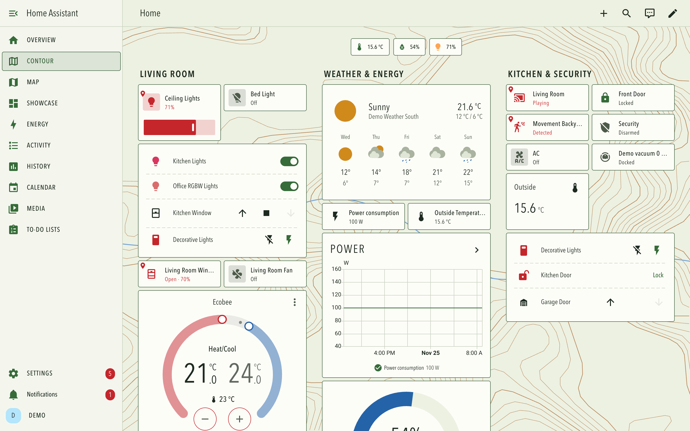
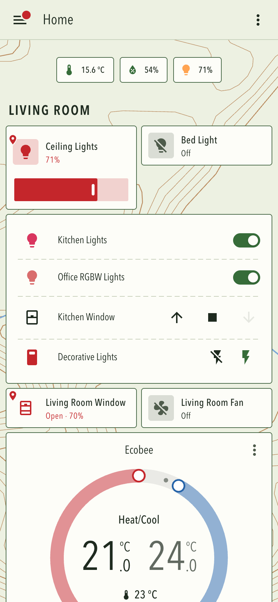
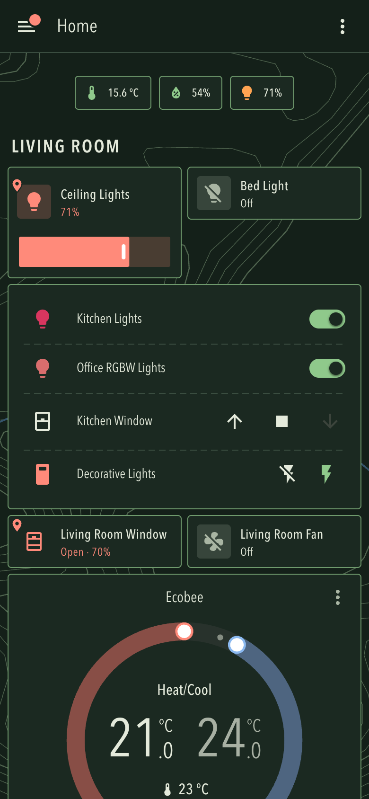
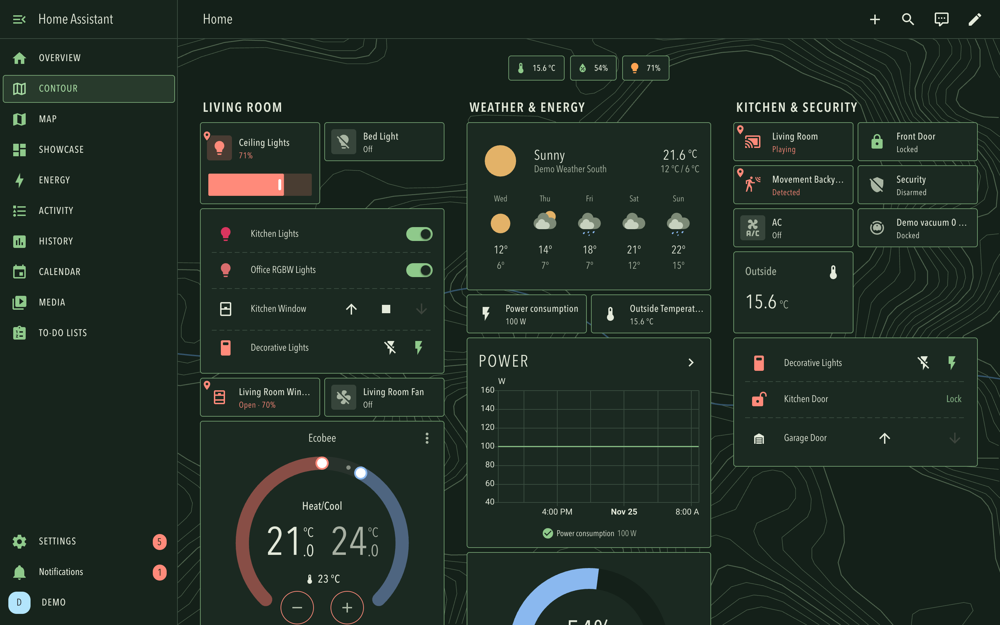
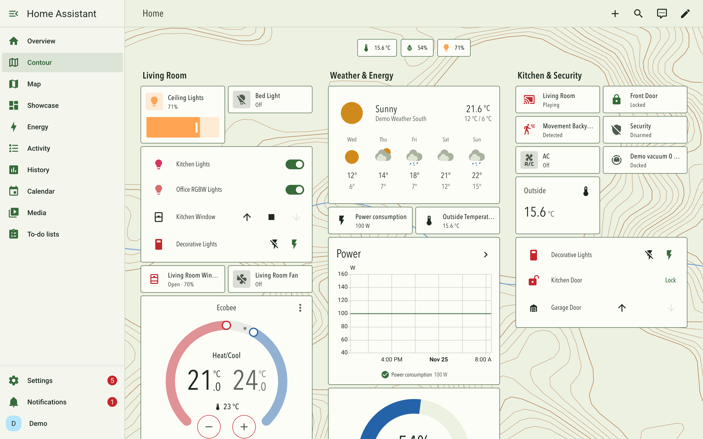
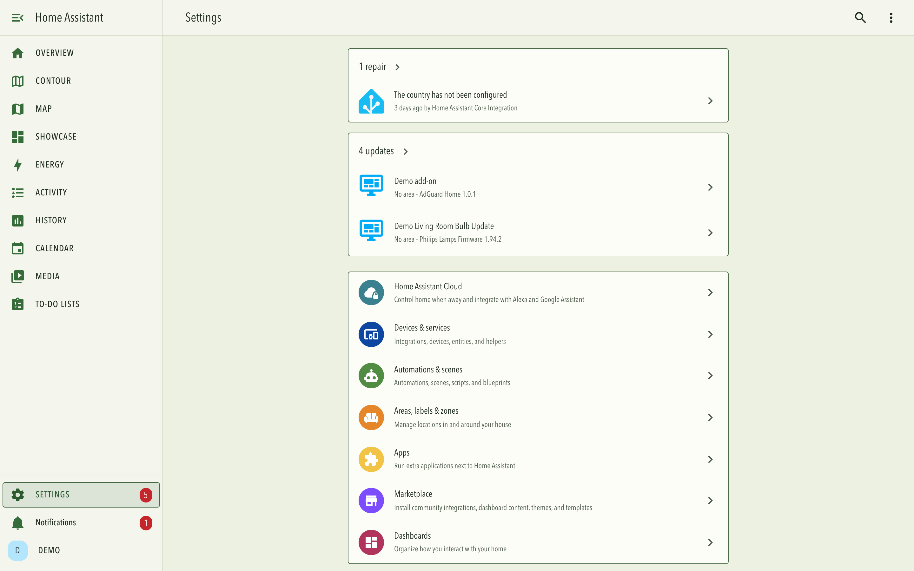
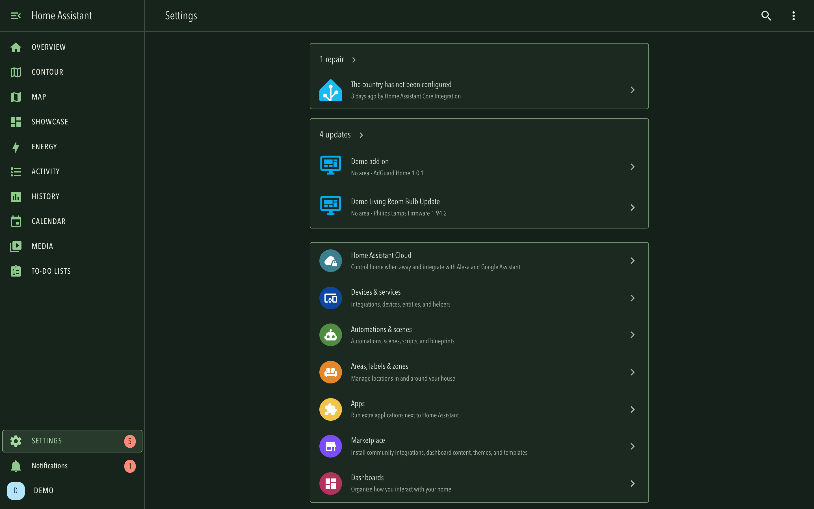

# Contour

[](https://my.home-assistant.io/redirect/marketplace_repository/?owner=wsclx&repository=contour-theme&category=theme)

A theme for Home Assistant in the style of a printed hiking map. Fine brown contour lines and a river run across a pale map green, cards sit on top as white map sheets with a thin forest-green rim, and everything that is on, open or playing is marked in road red. The dark mode is a night map: light contour lines on deep forest green. Light and dark mode in one theme.



| Light | Dark |
|---|---|
|  |  |



## What you get

- **One theme, two modes.** Light: a day map on pale green. Dark: a night map of its own on deep forest green, not an inverted day map. It follows the light or dark setting of your profile or device.
- **Contour background.** The relief behind your dashboards is an SVG embedded in the theme (about 12 KB per mode). Nothing is downloaded, and the lines are quiet enough that section titles on top of them stay readable.
- **Map sheets.** Cards are white (dark: deep green) sheets with a thin forest-green rim, corners rounded by just 4 px like a cut sheet, and no shadow, because print is flat.
- **Five map inks, nothing else.** Forest green for buttons, links, switches, selection and the keyboard focus; contour brown for charts; water blue for sliders, gauges and information; road red for active devices and errors; ink for text. Every other colour the frontend asks for (purple, pink, yellow and so on) is mapped onto one of these inks, and the red, orange, green and blue scales behind alerts and buttons are derived from them. All text meets WCAG 4.5:1 in both modes; switches, fields, sliders, card rims and the focus ring meet 3:1. The exception is the thermostat ring: the frontend draws its arcs half transparent, so they stay below 3:1; its handles and numbers carry the value.
- **Road red means active.** Lights, switches, fans, media players, open covers, detected motion and heating show their icon in road red, like a marked point on the map. Locks, alarms that are armed and people at home are forest green, anything pending is ochre.
- **Map density.** Sheets lie close together (6 px apart), section titles are set larger like the title of a map sheet, rows of entities cards get more air.
- **Scale-bar controls.** Tile sliders and buttons have 2 px corners like a map scale bar.
- **A narrow map face from your system.** Avenir Next Condensed on Apple devices, Bahnschrift on Windows, the condensed system sans on Android, narrow DejaVu or Liberation cuts on Linux. Nothing is downloaded.
- **Optional extras with card-mod:** a small red map pin and a red state line ("On", "Playing", "Open") on tiles of devices that are active, like a marked point with its label; coloured light tiles in road red instead of the bulb colour; lower tile sliders like a scale bar (with a mouse; on touch screens they keep the full finger size); dashed trail lines between the rows of entities cards; letter-spaced capitals for section titles, card titles, badges and the sidebar; the map face in the sidebar, a framed selection there like a legend entry, and a clear focus ring on badges and tiles.

Without card-mod the theme still works: background, sheets, inks, red active icons, switches and focus stay the same. There is no map pin and no red state line, coloured lights keep their own colour, tile sliders keep the default height, entities cards have no lines between rows, titles stay in mixed case, and the sidebar keeps the default font of the frontend.



| Settings, light | Settings, dark |
|---|---|
|  |  |

## Requirements

- Home Assistant with themes enabled. Tested with Home Assistant 2026.11.2 (November 2026).
- Optional: [card-mod](https://github.com/thomasloven/lovelace-card-mod) 4.x for the map pins and the other extras. Tested with card-mod 4.2.1.

## Installation

### Marketplace (HACS)

1. Open **Settings → Marketplace** (or HACS on older versions).
2. Search for **Contour** and download it.
3. Reload themes: **Developer tools → Actions → `frontend.reload_themes`**.

### Manual

1. Copy `themes/contour.yaml` into the `themes` folder of your configuration.
2. Make sure your `configuration.yaml` loads that folder:

   ```yaml
   frontend:
     themes: !include_dir_merge_named themes
   ```

3. Restart Home Assistant or run `frontend.reload_themes`.

## Use the theme

Open your **profile**, choose **Contour** under *Theme*, and pick *Auto*, *Light* or *Dark*.

## Optional: card-mod

The theme contains `card-mod-card`, `card-mod-badge` and `card-mod-sidebar` rules. They only apply when card-mod is installed. For theme rules, card-mod recommends loading it as a frontend module instead of a dashboard resource:

```yaml
frontend:
  themes: !include_dir_merge_named themes
  extra_module_url:
    - /local/community/lovelace-card-mod/card-mod.js
```

Adjust the path to where card-mod is installed on your system.

Sections dashboards with **tile cards** show the map pins; **entities cards** read like a legend with dashed trail lines between the rows.

## Customise

Change the variables below in a copy of the theme, or override them with card-mod.

| Variable | Used for |
|---|---|
| `contour-paper`, `contour-paper-low` | Map green behind dashboards and pages |
| `contour-relief` | The contour background (an SVG data URL); set it to `none` for a plain map green |
| `contour-sheet`, `contour-rim` | Card background and the thin card rim |
| `contour-ink`, `contour-ink-soft` | Text and secondary text |
| `contour-forest` | Buttons, links, switches, selection and focus |
| `contour-road` | Active devices, errors and the map pin colour |
| `contour-water`, `contour-brown`, `contour-ochre` | Sliders and information, charts, warnings |
| `contour-font` | The narrow font stack |

## Known limits

- Grid squares (A1, B1 …) in the corner of each section, as on a printed map, are not part of the theme: a theme cannot tell in which column a card sits. Write them into your section headings if you like the look.
- One large map sheet with legend rows per section, as in a printed map, comes from the dashboard, not the theme: put a section's devices into one entities card.
- Red dashed trails on the map background are left out on purpose: road red means "active" in this theme.
- The contour lines behind the cards cannot follow your data; the small contour charts inside cards that a map-style mockup might show are not possible with a theme. Charts use the map inks.
- Icons stay Material Design Icons; a theme cannot swap icon sets. Weather icons are drawn by the frontend; the theme sets their colours (ochre sun, water-blue rain, pale clouds).
- Coloured lights keep their own colour in badges, in the rows of entities cards and in the light dialog. Without card-mod they also keep it on tiles, the sidebar keeps the default font of the frontend, and keyboard focus on a badge with a green icon shows only as a slightly thicker rim.
- The thermostat ring, the size of switches and the height of tile sliders are set by the frontend; the theme sets colours and corners (card-mod lowers the sliders). A frame around sliders is not possible.
- The narrow font depends on your device. Where none of the narrow faces is installed, the system UI font is used.
- On iOS and iPadOS the background scrolls with the page instead of staying fixed (Safari ignores fixed backgrounds there).
- On slow wall tablets a fixed background can make scrolling stutter. In a copy of the theme set `contour-relief: none` (plain map green) or remove `fixed` from `lovelace-background`.
- Home Assistant does not guarantee theme variables between releases. If something looks off after an update, please open an issue with your version.
- The card-mod rules target internal elements of the frontend. A frontend update can break them; the theme itself keeps working.

## Contributing

Issues and pull requests are welcome. Please include your Home Assistant version, card-mod version (if used), browser and a screenshot.

## License

[MIT](LICENSE)

This is a community project. It is not affiliated with or endorsed by Home Assistant or the Open Home Foundation. The contour background is generated for this theme and does not show a real place.
